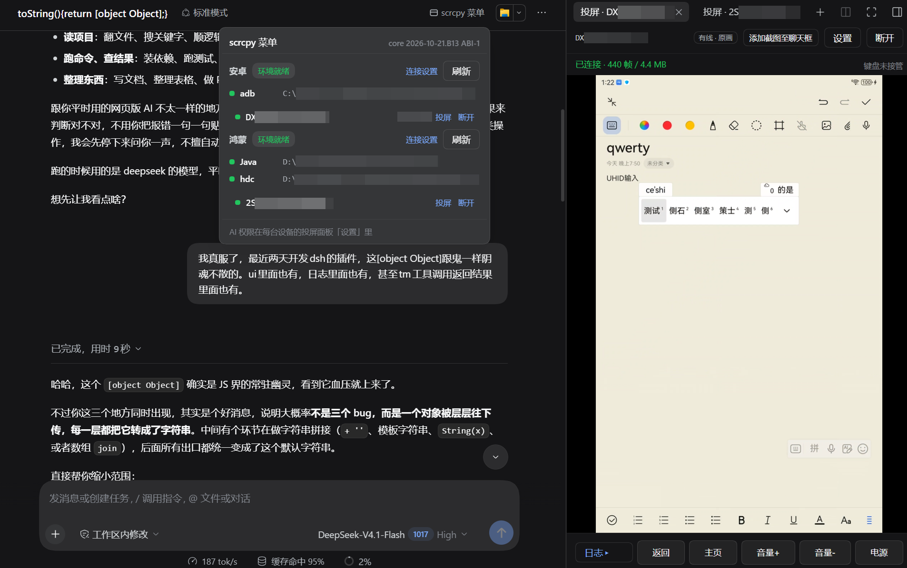

# dsh-scrcpy-core

**DSH 的投屏共用核心** —— 把手机/平板画面搬进 DSH，并且让 AI 能看、能点、能按。

装两个包就能用：**本包 + 一个平台 provider**（[安卓](https://github.com/ns-zzj/dsh-android-scrcpy) / [鸿蒙](https://github.com/ns-zzj/dsh-hos-scrcpy)）。
界面、AI 工具、提示词、权限、设备与聚焦，全在 core 里；provider 只负责"这台设备怎么连、怎么出画面"。

---

## 预览



---

## 为什么用它

| | 别的做法 | 这里 |
|---|---|---|
| **权限是硬门禁** | 给 AI 一把万能钥匙，靠提示词"请小心" | 每台设备**四项独立开关**（禁止 / 每次确认 / 无需确认）；关掉时工具**直接报原因**，不反复重试 |
| **多设备** | 一次只能连一台，换设备得断开重连；想同时看两台，第二台往往就把第一台顶掉 | 几台**同时投屏**，每台一张独立标签页、各自独立会话；安卓和鸿蒙能一起开着，操作只落在你看的那台 |
| **跨平台支持** | 两个平台各带一套界面，装在一起就抢同一个面板、互相打架 | 所有平台**共用一套界面、AI 工具和提示词**；provider 只声明"我能做什么"，没声明的能力会给**明确提示**，不静默失效 |
| **不绑定平台** | 只支持作者做过的那一个平台 | 谁都可以给 core 写一套 provider；装谁用谁，两个平台同时装也不冲突 |
| **暂停不占资源** | 切走就断流，回来重连 | 切走只暂停广播，回来**立刻出画**；暂停期间转过屏也不崩 |

---

## 能干什么

- **看画面**：鼠标点/拖 = 触摸，滚轮/按键映射由 provider 声明；转屏自动跟随，不用重连。
- **给 AI 用**：一套中性的工具名，注册一次，两个平台共用。

| 工具 | 作用 | 需要权限 |
|---|---|---|
| `scrcpy_devices` | 入口：列出已连接设备、当前聚焦哪台、四项权限状态 | 不需要 |
| `scrcpy_screenshot` | 截取当前屏幕，**图片直接给当前模型**（附一行文字说明；模型不支持图片时会收到 `[image omitted ...]`） | 允许截图 |
| `scrcpy_locate` | 读控件清单（`type/text/id/key/clickable/fx/fy/w/h`，比例坐标 0..1） | 允许控制 |
| `scrcpy_tap` / `scrcpy_longpress` | 按比例坐标点击 / 长按；执行前弹确认，**并在画面上闪绿点显示落点** | 允许控制 |
| `scrcpy_key` | 按 **provider 声明的**可用键（安卓 provider 目前是 `back` / `home`） | 允许按键 |
| `scrcpy_input` | 向当前聚焦的输入框注入文本（支持中文） | 允许输入 |

- **权限四项 × 三态**：`禁止使用` / `需要确认` / `无需确认`，「允许控制」「允许按键」「允许输入」**都依赖「允许截图」**。
- **电脑键盘直接打字**：投屏面板底部有「键盘输入启用开关」——
  打开它、点一下画面（状态变成「已聚焦，准备输入」），就能用**电脑自己的输入法**往设备里打字：
  候选词留在电脑、只把确认后的文字送过去；退格 / 回车 / 方向键也会发（安卓毫秒级，鸿蒙每键约 0.3 秒）。
  焦点不在画面上时一个字都不会发；关掉开关或点画面外就退出。
  - `Ctrl+V`：把**电脑**剪贴板的内容送进设备
  - `Ctrl+C`：把**设备**剪贴板取回电脑（需要鸿蒙 7.0+；不支持时静默忽略，不提示）
- **画质**：有线 / 无线**分别**配缩放与帧率（默认 `1/2`·60 与 `1/4`·30，两端都能到原画，帧率 120 封顶）。

---

## 安装

在 DSH 的**插件面板**里装两个包：先装 core，再装你要的平台 provider。

| 顺序 | 包 | 装什么 |
|---|---|---|
| 1 | `@nszzj/dsh-scrcpy-core` | 界面 + AI 工具（本包） |
| 2 | `@nszzj/dsh-android-scrcpy` 或 `@nszzj/dsh-hos-scrcpy` | 平台 provider，**按需装一个或两个都装** |

面板接受 npm 包名、本地 `.tgz` 路径、`github:` 规格三种形式。

**三件必须知道的事**

1. **core 要单独列出来装**。只装 provider 时 core 只是传递依赖，不会被登记成 bundle 层 —— 层不挂载，界面上不会有任何提示。
2. **装 provider 不会自动带 core**。没装 core 时 provider 的状态是 `pending (waiting for service: scrcpyProviders)`：不报错，但用不了，这是设计如此。
3. **装完插件要完全退出 DSH 再重新打开**（不是刷新页面，是退出程序）；「禁用」插件同样要重启后才真正卸载。

**环境要求**：DSH `>= 0.2.1`（`engines.dsh` 里声明的是 `>=0.2.1-0`，包含预发布版）。

---

## 版本与兼容

- 三个包**各自独立发版**、各自独立安装。
- 兼容性不看版本号，看一个整数：core 内置常量 `ABI`，provider 登记自己时声明 **`abi`**，**两个数字相等才算兼容**。
- **判定权在 core**：不相等（或 provider 没声明）就把该 provider 标成**停用** —— 设备不进列表、动作不路由，菜单那一组显示「**不兼容**」+ 具体原因（缺哪个数、要哪个数都会写出来），按钮位置显示它声明的 ABI 数字。
- 只有**破坏性变更**才让 `ABI` +1（注册字段 / 动作 / 返回值 / `capabilities` 语义变化）；改文案、加可选字段、修 bug 都不动数字 —— 所以"同一个 ABI 的任何 core 包 + 任何 provider 包"都能配。

---

## 已知限制

- **连接中途不能改缩放 / 帧率**：两个平台都不支持中途换档，改设置只对下次连接生效。
- **投屏是变化驱动**：画面静止时不推帧，帧计数/字节数不增长是正常现象。
- **"暂无画面"的含义按平台不同**：鸿蒙只在画面变化时推帧（提示用户滑一下手机），安卓没有这个提示。文案由 provider 能力声明。
- **模型不支持图片时看不到画面**：`scrcpy_screenshot` 会返回 `[image omitted because this model accepts text only; ...]` 并明确提示改用 `scrcpy_locate`，不会让它猜画面。
- **手动输入不受 AI 权限管**：那四个开关只管 AI 工具；面板里的键盘是用户自己的操作，任何时候都能用。
- **`Ctrl+C` 在输入区里被占用了**：它取的是**设备**剪贴板，不是本地选中的文本。
- **手动输入的速度和副作用按平台不同**（见各 provider 的 README）：打字都是整段注入、很快；按键的延迟差别比较大，个别平台的注入方式还会动到手机剪贴板。
- 菜单观感仍在调整。

---

## 开发者

写一个 provider：见 **[Provider.md](./Provider.md)** —— 注册字段、动作、capabilities、投屏流协议、坐标的坑都在里面。

```
dsh-scrcpy-core/
├── package.json          # dsh.bundle（本包是 bundle 层）+ dsh.client
├── cordis.patch.yml      # 只插 core 自己那一行 —— provider 各插自己的，谁都不许碰 core 行
├── lib/                  # 宿主半区：注册表 / 设备与聚焦 / 路由 / 工具 / 提示词 / RPC
├── client/               # 浏览器半区：全部 UI
├── resources/            # jmuxer.min.js（解码库，随包发）
├── Provider.md           # 怎么写一个 provider
└── README.md
```

**为什么每一行只有一个 owner**：`applyEntryPatches` 不按 id 去重 —— 两个 bundle 层各插一条同 id 条目，组合结果里会留下两条，挂载时被 `EntryGroup.update` 以 `duplicate loader entry id` 拒绝，**启动直接失败**。

## 许可

MIT。
